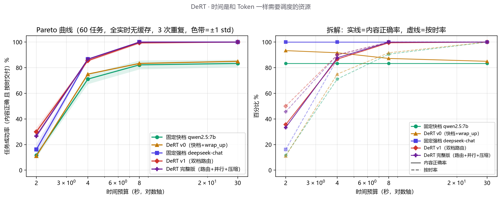

# DeRT — Deadline-aware Runtime for Tool-agents

> 把「时间」当作和 Token 一样的一等公民资源来调度的 Agent 运行时。
> 立项日期：2026-08-23 · 首个完整版本 2026-09-27
>

## 密钥管理（本仓库不包含任何 API 密钥）

**API 密钥红线**：本项目所有密钥只存在于本机用户级环境变量（`DEEPSEEK_API_KEY`），**任何项目文件中都不应出现 `sk-` 开头的字符串**。上传公开仓库前，人类协作者或执行上传的 agent 必须运行：

```powershell
# 项目根目录执行；任何输出命中 = 禁止上传，先清除
Get-ChildItem -Recurse -File -Exclude *.pyc |
  Where-Object FullName -notmatch '__pycache__' |
  Select-String -Pattern 'sk-[a-zA-Z0-9]{20,}' -List
```

同时确认 `.gitignore` 未被删除、`git status` 中无 `eval/cache/` 与 `eval/traces/` 被意外追踪。

## 核心论点

现有 Agent 框架的通病：延迟不可控、不可预测。用户问一个问题，回答可能 8 秒也可能 2 分钟。

DeRT 接受一个**显式时间预算**（如"10 秒内给出诊断结论"），并在执行过程中动态决策：

- 这一步用快模型还是强模型（预算路由）
- 哪些工具调用可以并行发出
- 上下文压到多短才能赶上预算

一句话：**时间是和 Token 一样需要调度的资源。**

### 但这个项目真正想回答的不是"能不能更快"，而是"调度到底在什么时候有用"

写完调度器、跑完 7100 多次受控运行之后，我得到的**不是一个普适的性能结论，而是两条边界**：

> 收官总结（理论命题 + 实践部署指南 + 局限 + 部署建议）见 **[docs/结论与实践指南.md](docs/结论与实践指南.md)**。

- **时间边界**：预算紧到"强模型根本跑不完"时（≤3s），把它塞进预算等于定时截断；预算宽到它从容跑完时，调度不带来收益。调度价值集中在中段——且边界位置随强模型延迟漂移（自适应阈值路由实测均值 +19.5pp）。
- **难度边界**：只有约 1/4 的任务真正需要强模型。按难度路由（v3）：紧预算禁用强档、宽预算放行——用 12% 的强档用量，把中宽预算档全面抬过快档基线（12s 档 87 vs 74），宽松预算 90%（快档天花板 74）。纯难度路由（v3b）与快档基线的交叉点恰好 ≈ 强档中位延迟：**强模型的价值只在预算 ≥ 其延迟时兑现**。

所以 DeRT 的价值主张不是"我的运行时更快"，而是：**我用可复现的实验，把"调度在什么条件下有用"的两条边界都测了出来，包括它在哪里没用。** 后者更难得——因为它要求我先证伪自己。

> 如果你只想看两个数字：宽松预算 90%（快档天花板 74，强档用量仅 12%）；以及两条曲线的交叉点恰好落在强档延迟上。如果你想知道这些数字能撑到哪、在哪会塌，往下读「我证伪了什么」。

## 差异化（查新结论，2026-08）

Deadline 调度在 **serving 层**已是研究热点（Metronome、PROSERVE、SmoothAgent），但**在 Agent loop 层把时间预算贯穿多步工具调用**，尚无开源运行时做这件事。主流开源 agent 的"预算"管理同样停留在成本维度（Cline 的日/月花费限额、OpenHands 的成本预算），时间维度仍是空白。DeRT 填的是这个空。

Related work（README 引用清单）：

| 工作 | 层级 | 与 DeRT 的差异 |
|---|---|---|
| Metronome (19PINE-AI) | serving 层 | 调度 KV cache 与会话周期，不感知工具链 |
| PROSERVE (arXiv 2512.12928) | serving 层 | 多优先级请求排序，单请求视角 |
| SmoothAgent (arXiv 2607.00151) | serving 层 | 长时程 agent 的 lookahead 上下文工程，不做预算分配 |

## 架构（四模块）

```
任务 + 时间预算
      │
┌─────┴──────────────────────────┐
│        自研 Agent Runtime       │   零框架 · ~3000 行 Python
│                                │
│  ┌──────────┐   ┌───────────┐  │
│  │ 主循环    │──▶│ 截止期调度器│──▶ LLM API 双档（快/强）
│  │ Loop     │   │ 预算·降级  │  │
│  │ (手写)   │   └───────────┘  │
│  │          │   ┌───────────┐  │
│  │          │──▶│ 上下文管理器│  │
│  │          │   │ 压缩·截断  │  │
│  │          │   └───────────┘  │
│  │          │   ┌───────────┐  │
│  │          │──▶│ 工具执行器  │──▶ 诊断工具集（模拟实时检测系统）
│  └──────────┘   │ 依赖·并行  │  │
│                 └───────────┘  │
└───────────────┬────────────────┘
                │ 每轮打点
                ▼
   基准任务集（50 个） → Pareto 曲线（成功率 × 延迟 × 成本）
```

## 设计问答

### Q1：serving 层已有时间管理（Metronome/PROSERVE），为什么还要做 loop 层？

信息所有权决定调度所有权。serving 层看到的是孤立请求，预算分配需要的三类信息只有 loop 层拥有：**任务结构**（剩余步数、工具依赖图）、**上下文内容**（丢哪段换 prefill 时间）、**任务语义**（规划步与收尾步的预算价值不同）。类比：serving 是路口红绿灯，loop 是全程导航。两层为上下游互补关系，且 loop 层方案纯应用侧可落地，无需推理基础设施控制权。

### Q2：给了 deadline，能力会降低吗？能否接受？

会降低，且"降低多少"正是 Pareto 曲线要量化的核心数字。但对比基线要修正：无 deadline 的 agent 延迟长尾随机，用户打断后任务成功率归零，"无限预算 + 无限耐心"的基线不存在。正确表述：现状 = 延迟与能力均随机；DeRT = 延迟确定 + 能力有保证下限。典型权衡："牺牲 13 个百分点成功率，把 P95 从 87s 压到 9.2s"。是否接受由场景决定——交互式场景选低延迟档，批处理选高质量档，DeRT 把这个选择权从听天由命变成显式参数。

### Q3：耗时受多阶段/多工具影响，具体怎么调度？

四件套机制：

1. **耗时分位数预测**：每工具、每模型档维护 P50/P95 分布（EMA 在线更新）；P50 做预算、P95 做熔断，不用均值（LLM 延迟长尾）
2. **贪心预算分配**：剩余预算 ÷ 预估剩余步数 = 步预算；每步选满足 TTFT + 工具耗时 < 步预算的最强模型档；v1 不引入 RL
3. **动态修正**：每步结束重算；工具超时触发降级；余量 < 2s 进入收尾模式（快模型 + 现有信息直接总结）
4. **工具耗时三治理**：并行化（依赖图分析）／降精度（fast/full 两档参数，分析工具支持降采样）／硬熔断（超时返回部分结果）

### Q4：2s 档你靠"内容正确率只有 36%"赢，这不是在刷指标吗？

这是本项目最该被质疑的一点，我认为必须正面回答，而且**答案要带着前提**。

先澄清口径：成功 = 内容正确 **且** 按时。"按时但缺数值"不算成功——判分要求答案里必须出现正确的数值。所以 36% 是"按时交付的那一半里，数值还在的比例"，2s 档真正的成功是 30%，不是靠放宽正确率凑出来的。

再说这个权衡为什么成立、以及它依赖什么：

- **成立的场景**：值班/告警。运维要的是"P95 是 11.13ms、没超红线"这一行，不是三段解释。此时"按时给数" > "迟到给全"。固定强档 100% 正确但只有 16% 按时，等于 84% 的情况是**迟到的废答案**。
- **它依赖的前提**（必须承认）：这个前提是**我设定的**，不是普适真理。判分器只查数值与方向词，所以它奖励"把数写进第一行"。换成"要完整诊断报告"的任务，结论会反转。
- **我不主张什么**：我不主张"截断是对的"。我主张的是——**当预算成为硬约束时，"按时 vs 完整"是一个必须被显式做出的取舍，而固定策略连做这个取舍的机会都没有**（它只会迟到）。DeRT 把它变成了一个可配置的参数，并用 2520 次运行测出了这个取舍的代价与收益。

**如果读者不认可这个前提，那 2s 档的结论就不适用。**

## 评估设计（摘要）

- **基准**：100 个任务（34 简单查询 / 33 单步诊断 / 33 多工具复杂诊断）× 4 档预算，8 个工具**全部被真实调用**（覆盖度经实测确认），详见 [benchmarks/tasks-design.md](benchmarks/tasks-design.md)
- **两轮评估**：①网格版（60 任务 × 5 策略 × 3 重复，量化噪声）；②**配对版**（100 任务 × 3 策略 × 4 预算，A/B/C 同任务配对、交替轮转、bootstrap CI + McNemar 精确检验 + 质量分 sign test）——2026-10-22 重建，工具链 `eval/budget_eval.py`（采集，断点续跑）+ `eval/analyze_budget.py`（离线分析）
- **策略**：固定快档 / 固定强档 / DeRT v0（快档+收尾）/ DeRT v1.1（双档路由）/ DeRT 完整版（+上下文压缩）五线对比（配对版取前三 + v1.1）
- **成功判定**：内容正确（规则判分）且 实际耗时 ≤ 预算——格式遵循（`FINAL:` 前缀）只作过程观测不作判分依据（deepseek-chat 实测结构性不遵守该前缀但内容全对，按格式判分会失真）
- **口径**：最终曲线必须含一轮全实时无缓存运行；开发迭代走响应缓存控成本

## MVP 结果（2026-09-29，正式版：60 任务 × 5 策略 × 4 预算 × 3 重复，全实时无缓存，2520 次运行零错误）

> 这一节给数字，**结论的边界与三项负结果在下一节「我证伪了什么」**——只看这一节会高估这个项目。

成功率 = 内容正确 且 按时交付（mean ± std，跨 3 次重复）：

| 策略 \ 预算 | 2s | 4s | 8s | 30s |
|---|---|---|---|---|
| 固定快档 qwen2.5:7b（本地） | 12±2 | 71±4 | 82±3 | 83±3 |
| DeRT v0（快档 + wrap_up 收尾） | 11±1 | 75±0 | 83±0 | 85±0 |
| 固定强档 deepseek-chat（云端） | 16±5 | 87±0 | 100±0 | 100±0 |
| **DeRT v1.1（双档路由 + 自适应收尾）** | **30±3** | 86±1 | 99±1 | 100±0 |
| **DeRT 完整版（v1.1 + 上下文压缩）** | 27±2 | **87±0** | **100±0** | **100±0** |



数据：`eval/results/pareto_20260929_1820.json` · 复现：`python -u eval/pareto_routine.py --with-strong --dert-v1 --compress --repeats 3 && python eval/plot_pareto.py`

**一句话**：不换模型、不换任务，只靠把时间预算当调度依据——**紧预算 2s 档 DeRT 拿到 30%，两条固定基线的外包络只有 16%（+14pp）**；4s 及以上 DeRT 与「该预算下最好的那个模型」持平（86/99/100 对 87/100/100，差值 ≤1pp，落在跨重复标准差内），而完整版（+上下文压缩）在**全部四档都不低于两条基线的外包络**。两条固定基线各有一段被卡死：快档 30s 档封顶 83%（能力上限），强档 2s 档只有 16%（TTFT P50=0.53s，首 token 就吃掉四分之一预算）。

**过程指标拆解（正确率 / 按时率，全重复合并）**——这张表比成功率更有信息量：

| 策略 \ 预算 | 2s | 4s | 8s | 30s |
|---|---|---|---|---|
| 固定快档 | 83/12 | 83/71 | 83/91 | 83/100 |
| DeRT v0 | 93/11 | 92/75 | 87/92 | 85/100 |
| 固定强档 | 100/16 | 100/87 | 100/100 | 100/100 |
| DeRT v1.1 | 36/50 | 87/90 | 99/100 | 100/100 |
| DeRT 完整版 | 33/46 | 88/90 | 100/100 | 100/100 |

**2s 档的胜负手在这里**：固定快档内容对 83% 却只有 12% 按时（跑不完），固定强档 100% 正确但只有 16% 按时（TTFT 就吃掉一半预算）；DeRT v1.1 主动**用内容换时间**——正确率降到 36%，但按时率提到 50%，净成功率反而最高。这正是「把时间当一等公民」的实证：**它敢在预算不足时交付一个不完整的答案，而固定策略只会迟到**。

**噪声量化结论（3 重复的核心产出）**：① 噪声随预算收紧单调放大（2s 档 std 2–5pp → 8s+ ≤1pp），主因是**边界悬崖效应**——大批任务耗时贴着预算线，毫秒级服务抖动即翻转成败；② TTFT 分布坐实（本次实测）：deepseek P50=0.53s / P95=0.78s，qwen P50=0.10s（8 工具 schema 下）；③ 2s 档失败构成：固定强档是「对但迟」（正确 100% 但按时仅 16%），DeRT 是内容截断（正确 36%）——调度器把「迟到问题」换成了「内容完整性问题」，交换在紧预算下划算、在宽预算下无必要，故只在预算不足时触发；④ 30s 档 qwen 天花板 83%（能力上限）vs DeRT 100%（强档路由补齐）。

**与 2026-08-25 那版数据的关系（必须说明，否则两条曲线不可比）**：旧版是 50 任务 × 4 工具；9/28 起任务集扩到 60 条并补到 8 个工具，schema 变长使本地 qwen 单次 TTFT 从 0.148s 涨到 ~0.44s，同时新增的 T2 阈值判断类任务对 7b 偏难。结果是**本地基线整体下移**（快档 2s 档 29%→12%、30s 档 86%→83%），强档基本不变——DeRT 与基线的差距因此拉得更开。旧版数据保留在 `eval/results/pareto_20260825_2035.json` 供对照，但**两者不可混用**（任务集与工具集都变了）。

> ⚠️ **在引用上面这组数字之前**：另有一轮同样规模（2520 次）的运行因环境缺陷**全部作废**（本地端点 IPv6 回退，每次调用白扣 2 秒，qwen TTFT 被抬到 2.22s），复盘见「我证伪了什么 ③」。作废数据与说明存于 `eval/results/invalid/`。教训：测量管路本身要先被验证，否则跑得越久错得越贵。

### 调度器 v2 迭代记录（同晚对照，负结果）

> ⚠️ **本小节数据来自旧的 50 任务集（2026-08-25），仅作迭代过程记录，不与上方 60 任务数据横向比较。** v2 未进入 9/29 的正式网格：它是已定案的负结果，重测要多花约 30% 成本且不产生新结论；代码保留在 `src/scheduler.py` 供复现（`--dert-v2`）。

v2 = 量化路由（强档任务耗时滑窗 P60 在线估计替代固定 3.5s 阈值，后端变慢自动回落快档）+ 收尾数值优先（token 下限 30→40 + 「第一行先给数值与判断结论」指令，截断只伤解释不伤判分点）。同晚全网格对照（5 策略 × 50 任务 × 4 预算 × 3 重复，3000 次运行零错误，`eval/results/pareto_20260825_2253.json`）：

| 策略 \ 预算 | 2s | 4s | 8s | 30s |
|---|---|---|---|---|
| DeRT v1.1 | 35±1 | 83±1 | 97±3 | 100±0 |
| DeRT v2 | 30±4 | 81±1 | 97±1 | 100±0 |

**设计目标达成一半，净效果为负**：2s 档内容错从 61/150 降到 33/150（数值优先指令确实治了内容截断），但收尾生成变慢使「对但迟」从 36 涨到 72（中位迟到 2.14→2.33s），净 -5pp——失败模式从「内容截断」搬到了「迟到」，交换不划算。结论：**v1.1 仍是当前最优配置**；紧预算下「按时 vs 完整」的权衡需要比「多给 token」更聪明的手段（如把判分点结构化后让模型按优先级填充），留作后续迭代。注：同晚数据可严格对比两版本；跨晚绝对数字受服务波动影响（当晚 2s 档各策略整体比前晚低 5–8pp，deepseek 状态更好使强档基线 8s 冲到 98.7——「全档 ≥ 外包络」的结论成立性依赖当晚服务状态，紧预算档的显著优势才是稳定结论）。

## 配对评估（2026-10-22 重建版：100 任务 × 3 策略 × 4 预算 = 600 次运行）

针对旧网格的三处缺口重建了评估：任务集 60→100（判分工厂复用，自测全过）、A/B/C **同任务配对**（每任务 6 次运行交替轮转执行，消除顺序偏差）、bootstrap 95% CI + McNemar 精确检验（替换"均值±std"的粗糙口径）。预算档改为 **{3, 8, 30, 60}s**：3s 在路由阈值 3.5s 之下（专门看降级行为），8s 临界，30/60s 宽松。

主结果（success% = 内容正确 且 按时，bootstrap 95% CI，N=100 配对）：

| 策略 \ 预算 | 3s | 8s | 30s | 60s |
|---|---|---|---|---|
| A 固定强档 deepseek-chat | 48 [38,58] | 98 [95,100] | 100 [100,100] | 100 [100,100] |
| **B DeRT v1.1** | 43 [33,53] | **95 [90,99]** | 100 [100,100] | 100 [100,100] |
| C 固定快档 qwen2.5:7b | 37 [28,47] | 72 [63,81] | 73 [64,81] | 73 [64,81] |

**三条可引用的配对结论（McNemar 精确检验）**：

1. **8s 临界档：DeRT 显著优于快档基线**（不一致对 28/5，p<0.001），与强档统计持平（0/3，p=0.25）——预算刚够上强档时，调度器拿到了强档的结果，且没多花预算。
2. **30/60s 宽松档：DeRT 与强档完全一致**（100% 对 100%，不一致对 0/0），显著优于快档（27/0，p<0.001）。C 的 73% 是 qwen 内容正确率天花板（correct 恒 73%），调度救不回来——这解释了旧网格 30s 档 83% vs 100% 差距的来源。
3. **3s 阈值下档：全员失效区，无显著差异**（B vs C 10/4，p=0.18）。**诚实记录：旧网格 2s 档 +14pp 的紧预算优势在本轮 3s 档没有复现**（+6pp，不显著）。归因：紧预算收益依赖「预算 / 任务耗时」之比而非预算绝对值——2s 时快档自然按时率仅 12%，wrap_up 收尾是主要功臣；3s 时快档自己能按时跑完 38%，收尾的边际价值缩小。**收益是比值的非线性函数，不是"紧预算"的常量函数**——这本身是本研究的一个发现。

调度行为验证（过程指标，路由器是否按设计工作）：

| 预算 | B 强档调用占比 | B wrap_up 触发率 | 平均换档次数 |
|---|---|---|---|
| 3s | 0% | 46% | 0（粘性路由） |
| 8s / 30s / 60s | 100% | 0% | 0 |

质量分（deepseek judge，1–5 rubric，temp=0，参考答案=工具真实数据，与规则判分独立）：A=4.98；B 在 3s 降到 3.97（降级到快档，质量随行——这是设计行为），8s+ 回到 4.96–4.98 与 A 持平（sign test 平局 100/100）；C=3.86（correct 天花板的另一面）。

数据与复现：`eval/results/budget_main100/{raw.jsonl, env.json, summary.json, summary_stats.json, report.md}`（600 条逐行记录可溯源；采集含一次网络挂起中断，断点续跑补齐，事故与两阶段窗口如实记录在 env.json）：

```bash
python -u eval/budget_eval.py --run-id main100          # 采集（可断点续跑）
python -u eval/analyze_budget.py eval/results/budget_main100   # 离线分析→report.md
```

## 密集扫描（2026-10-22 sweep2：100 任务 × 3 策略 × 8 预算 = 1000 次运行）

针对「时间策略稀疏」的批评补的 1s 分辨率扫描：预算 {2,3,4,5,6,8,10,12}s。强档换为百炼 deepseek-v4.1-flash（原 deepseek-chat 因欠费不可用），任务集/快档 qwen2.5:7b/调度器与 main100 完全一致——**唯一变量是强档后端，因此本轮同时是一次泛化实验：换了强档，边界结论还成立吗？**

主结果（success%，N=100 配对）：

| 策略 \ 预算 | 2s | 3s | 4s | 5s | 6s | 8s | 10s | 12s |
|---|---|---|---|---|---|---|---|---|
| A 固定强档 v4.1-flash | 0 | 0 | 3 | 23 | 47 | 71 | 84 | 91 [85,96] |
| **B DeRT v1.1** | **26** | **48** | 3 | 26 | 48 | 74 | **84** | **90 [84,96]** |
| C 固定快档 qwen2.5:7b | 16 | 42 | 59 | 63 | 67 | 73 | 73 | 73 |

**两条可引用的结论**：

1. **泛化成立，且边界位置=强档延迟分布的函数**。强档变慢（单次 agent 运行 4.5–8.6s）后，B 追平 A 的位置从 ~8s 右移到 ~10s（10s：84 vs 84，p=1.0；12s：90 vs 91，p=1.0）；而极紧档优势反而放大——2s/3s 档 A（慢强档）on_time=0%，B 靠快档+wrap_up 保住 26%/48%（B vs A 均 p<0.001）。**边界不是固定值，它跟着强档延迟分布走**——这比「边界在 8s」更接近本研究想说的事。
2. **发现路由死区（新失败模式）**：4s 档 B 崩到 3%，惨败于快档基线 C=59%（McNemar 不一致对 **0/56，p<0.001**）。根因：`STRONG_REMAINING_MIN=3.5s` 是针对旧强档延迟标定的常数，预算落在 [3.5s, 强档实际延迟] 区间时调度器**确定性选择一个注定迟到的模型**（4s 档 B 100% 上强、on_time 仅 3%）。**固定阈值路由对后端延迟漂移不稳健**——这是 v2 滑窗分位数路由（在线估计强档耗时）迄今最硬的实证动机。

C 的 correct 恒 73%，与 main100 完全一致（同为 qwen2.5:7b，两轮独立采集数字相同，顺带验证了量具稳定性）。数据：`eval/results/budget_sweep2/`（1000 条逐行记录 + report.md 含死区根因分析）。

```bash
python -u eval/budget_eval.py --run-id sweep2 --budgets 2,3,4,5,6,8,10,12 --no-judge --strong-provider bailian
python -u eval/analyze_budget.py eval/results/budget_sweep2
```

### 死区修复实验（2026-10-23：v2.1 自适应阈值，800 次运行）

「发现问题 → 定位根因 → 修复 → 验证」的完整闭环。三步：①**离线回放**（`eval/replay_threshold.py`，零 API 成本）：用 sweep2 的 1441 次强档真实耗时模拟任意阈值下的决策，模型校验最大偏差 3.7pp；结论——最优固定阈值 8.5s（+15.2pp），且 **6.5–10s 是平坦高原**（阈值无需精调），逐任务 oracle 上限 72.4%（差值留给难度感知路由）。②**实现 v2.1**（`DeadlineSchedulerV21`）＝v2 滑窗 P60+0.5 自适应路由 + v1.1 收尾（数值优先因净 −5pp 不掺入）。③**在线对照**：同 run-id 补采 800 个 v2 格，与 A/C/v1 同任务同天配对。

主结果（success%，N=100 配对，McNemar 精确检验）：

| 时限 | 2s | 3s | 4s | 5s | 6s | 8s | 10s | 12s | 均值 |
|---|---|---|---|---|---|---|---|---|---|
| v1.1 固定阈值 3.5s | 26 | 48 | **3** | 26 | 48 | 74 | 84 | 90 | 49.9 |
| **v2.1 自适应阈值** | 27 | 59 | **84** | **76** | **76** | 81 | 76 | 76 | **69.4** |
| v2 − v1 | +1 | +11* | **+81** | **+50** | **+28** | +7 | −8 | **−14*** | **+19.5** |

（* = p<0.05；4s 档 81/0 不一致对，p=8.3e-25）

**两条可引用的结论**：

1. **死区被填平**：4/5/6s 三档 +81/+50/+28pp（全部 p<0.001）。且 v2.1 在 2–6s 全线显著优于快档基线 C（如 4s 档 84 vs 59，p=4.2e-07）——**调度价值=选对模型+按时收尾兜底**：快档路径配预算感知 wrap_up，比"裸跑快档"和"迟到强档"都强。
2. **诚实的回撤**：12s 档 v2.1 比 v1.1 差 14pp（76 vs 90，p=0.004）。根因：强档任务耗时分布重尾（4.5–21s），P60 估计≈10.5s 偏保守，高预算档错失强档胜局（强档在 12s 档 on_time 91%）。**单点估计+边际的阈值规则在两端不对称的风险下不够用**——修复方向已明确：改为比较窗口经验 CDF（P(强档总耗时 ≤ 剩余) ≥ 0.6），可用零成本回放先验证，留作下一步。

数据：`eval/results/budget_sweep2/`（raw.jsonl 1800 条含 v2 格；`threshold_replay.json` + `v2_analysis.json`）；分析脚本 `eval/replay_threshold.py` / `eval/analyze_v2.py`。

### 路由规则对比回放（2026-10-23 下午：「问平均 vs 问概率」小设计验证，零 API 成本）

用户提议对比两种阈值设计：「问平均」（v2.1 现行，窗口 P60+边际）vs「问概率」（窗口经验 CDF：P(强档耗时≤剩余)≥p）。回放结果（`eval/replay_rules.py`，按 v2.1 真实执行序逐决策重放）：

| 规则 | 均值 | 结论 |
|---|---|---|
| R1 问平均（margin 0/0.5/1.0） | 63.5 / **65.5** / 64.6 | 二者几乎等价 |
| R2 问概率（p=0.5/0.6/0.7） | 64.0 / 63.5 / 63.8 | 同上 |
| R3 问平均+新鲜度探针（每 15/20/30 次） | 59.7 / 58.8 / 59.7 | 反而更差 |

**两个比结论本身更有价值的发现**：

1. **R1≈R2 是结构性的**：「P60+边际 ≤ 剩余」与「P(≤剩余)≥p」在数学上是同族规则（都是窗口分位数阈值），比不出胜负——这个对比实验证伪了"换问法就能修回撤"的假设。
2. **模拟器校验失败（最大偏差 23.5pp）暴露了真凶**：重建 v2.1 的真实估计轨迹后发现**估计器棘轮+饿死锁死**——est 从 5.1 单调爬升到 12.24 后冻结，**后半程 300 次运行强档调用率为 0**（窗口只被强档运行喂养→est 升高抑制强档调用→窗口断粮→est 永远无法回落）。12s 档回撤的真因不是"P60 保守"，是这个正反馈死锁。而加探针（R3）也救不回来：探针让窗口更紧地跟踪**近期任务难度构成**（T2/T3 段全是慢任务），est 依旧高企——**窗口把"后端速度"和"任务难度"混在一锅才是根本缺陷**。
3. **真正的修复方向**：估计"后端速度"（每次强档调用的 TTFT/生成速率，与任务难度无关）而非"任务总耗时"；或按任务难度归一（= v3 难度感知路由的具体机制）。回放同时揭示：任务按 T1→T2→T3 定序执行放大了构成污染（生产负载随机交错时较轻）——评估设计的一点局限性，如实记录。

本次为纯回放结论（模拟器快档路径低估 wrap_up 价值 23.5pp，规则间对比共享该偏差仍有效；上线前需在线确认）。

### 难度感知路由（2026-10-24：v3/v3b 干净复测，故事闭环）

时间驱动路由（v1.1/v2.1）回答"什么时候该用强模型"，但没有回答"这个任务**配不配**用强模型"。sweep2 已给出成本上限：C 的 correct 天花板 74% → 只有约 26% 的任务真正需要强模型。v3 的答案是**按任务难度路由**：可部署的难度信号取「数值对比措辞」（问句含「是否超过/SLO/红线/对照」等——sweep2 中含此措辞的任务快档错误率 48%，不含的 16%）。

v3 首测（10-23）被本机游戏污染，62.4% 的失败结论系污染数据，已作废。经两轮测量事故清理（本机重启冷加载窗口、百炼云侧慢响应各隔离一批，共 1457 条入 `invalid/`），10-24 断点续跑补全 4000 条干净数据。主结果（success%，N=100 配对）：

| success% | 2s | 3s | 4s | 5s | 6s | 8s | 10s | 12s | 30s | 60s |
|---|---|---|---|---|---|---|---|---|---|---|
| **v3 难度路由+8s 时间门**（12% 强档） | 32 | 58 | **82** | **72** | **77** | 78 | **84** | **87** | **90** | **91** |
| **v3b 纯难度路由**（31% 强档） | 20 | 45 | 57 | 55 | 64 | **79** | **82** | **85** | **90** | **90** |
| C 固定快档 | 16 | 42 | 60 | 64 | 68 | 74 | 74 | 74 | 74 | 74 |
| A 固定强档（100% 强档） | 0 | 0 | 3 | 23 | 47 | 71 | 84 | 91 | 100 | 100 |

**三条可引用的结论**：

1. **快档质量天花板被打破**：v3b 在宽松预算下 90% vs C 74%（McNemar 16/0，p=3e-5），强档用量仅 31%——回放预测（correct 88.9%、强档 31.3%）双双命中。难度信号本身干净：硬任务 310 次运行 100% 走强档、易任务 690 次 0% 误招；硬任务走强档 correct 96.8%（@30/60s）。
2. **教科书级交叉结构**：v3b vs C 逐预算配对——≤3s 显著更差（2s 档 9/60，p=2e-10：把中位耗时 6.4s 的强模型塞进 2s 预算等于定时截断），4–5s 打平，≥6s 单调转好。**交叉点 ≈ 强档中位延迟：强模型的价值只在预算 ≥ 其延迟时兑现**——这是「时间是需要调度的资源」这条主线最硬的一条实证。
3. **时间门与难度信号是互补而非二选一**：v3b（纯难度）在紧预算被强档延迟拖垮，v3（难度+8s 时间门）紧预算禁用强档、高预算放行，两头都拿到——全局 correct 80.0%（v3b 75.9%；v3 vs C 138/78，p=5.4e-5），**当前全场最优单策略**。v3 的 8s 门是按强档延迟手拍的；下一版 v3c 把这个门换成 v2.1 的自适应分位数估计（随强档延迟漂移自动跟随），两条线在此合流。

数据：`eval/results/budget_sweep2/`（raw.jsonl 6000 条全量 + `v3_analysis.json`）；图 `docs/figures/v3_clean_rerun.png`（`eval/plot_v3_clean.py`，六策略主曲线，v3d 为加粗冠军线）；分析 `eval/analyze_v3.py`。测量事故的隔离记录与判据见 `eval/results/invalid/` 下两个 README（本机污染 / 云侧慢窗口）。

#### v3c：自适应时间门（2026-10-24 下午，混合结果——门收敛成功，峰值不敌手拍）

v3 的 8s 门是照着强档延迟手拍的；v3c 把它换成强档任务耗时的在线 P60+0.5（窗口只由强档任务构成，宽预算档天然探针防棘轮锁死；冷启动先验 7.5+0.5=8.0 与手拍值重合）。1000 格在线对照（同 run-id 补采）：

- **门机制本身验证通过**：轨迹 8.2→7.1→7.7→8.2–8.6s，最终 8.6s，落在回放平台（6.5–10s）内，无棘轮锁死——「估计后端、而非猜任务」的路线是通的。
- **但峰值性能不敌手拍**：8s 档门低谷（7.1–7.7s）放行了 14 个强档调用、5 个超预算迟到（v3c 66 vs v3 78，p=0.023）；10s 档门尖峰误拦 8 个难任务（70 vs 84，p=0.0043）；12s 以后无显著差异（60s 档 90=91）。**在预算≈门界的档位，在线门的决策抖动本身就成了成本——它偶尔放行注定迟到的调用、偶尔误拦来得及的任务；手拍常数 + 边界效应反而是一个干净的阶跃。**
- **附带的重要发现（噪声标尺）**：v3c 与 v3 在 2–6s 行为完全相同（0% 强档、同收尾机制），但独立采样的逐档差高达 8–16pp（4s 档 3/18，p=0.0015）。**悬崖预算档（4–6s）的单次采样点估计有 ±15pp 级不可复现性**——本节表格里 v3@4s=82 应视为幸运高值（同档独立采样 C=60 / v3b=57 / v3c=67）。跨运行的严格对比需要多重复采集；单会话内的配对比较不受此影响。

结论：**v3（手拍门）保持冠军**。v3c 的负结果把"免标定"的代价标清楚了；若要走自适应路线，估计对象需换成 call 级后端延迟（无删失、无任务重尾污染）并加滞回带防抖（v3d，未开工）。分析：`eval/results/budget_sweep2/v3c_analysis.json`。

#### v3d：稳态自适应门（2026-10-24 晚，达成目标——配对不劣于 v3 且全程免标定）

v3c 的失败诊断（门方差，而非估计偏差）给出四处修复：①删失过滤（被收尾截断的任务耗时 ≈ 预算值，不进窗口）；②离群截断（>3×中位数剔除，强档耗时重尾至 26s）；③门的变速率限制（每任务最多移动 ±0.3s——窗口可以抖，门不许追着抖）；④**先验地板 8.5s + 只向上自适应**（后端变慢 → 门上调自保护；向下回调需要比滑动分位数更强的证据，换更快模型的场景交给标定卡）。1000 格在线对照：

| success% | 2s | 3s | 4s | 5s | 6s | 8s | 10s | 12s | 30s | 60s | 均值 |
|---|---|---|---|---|---|---|---|---|---|---|---|
| **v3d 自适应门** | 32 | 60 | 82 | 79 | 84 | **83** | 81 | **88** | **90** | **93** | **77.2** |
| v3 手拍门 | 32 | 58 | 82 | 72 | 77 | 78 | 84 | 87 | 90 | 91 | 75.1 |

- **判定标准全部达成**：8s 档强档调用 0（v3c 是 14，门地板守住了）；逐档配对无一处显著劣于 v3（5s/6s 档反而 8/1 更优，p=0.039——行为相同档位属噪声方向）；均值 77.2 vs 75.1，为全部策略最高。
- **门轨迹健康**：稳态 8.5s，唯一一次上探 10.86s（慢任务顶高窗口）在 3 个任务内自动回落——上探造成 10s 档强档用量 24% vs v3 的 31%，代价 3pp（p=0.55，不显著）。
- **标定卡交叉验证（`eval/calibrate_gate.py`，20 难任务 ≈¥0.1/3 分钟）**：当晚标定推荐门 7.15s ≠ v3d 在线收敛 8.5s——**同一估计对象、同一公式、差 1.35s，跨时段漂移是真实的**。这把两条路线的关系钉死了：固定门（标定卡）按次有效、需随会话重标；自适应门（v3d）免标定且对漂移自保护。**完备形态 = 二选一或并存：部署时一张标定卡，或运行时 v3d 自适应。**

数据：`eval/results/budget_sweep2/`（raw.jsonl 6000 条）+ `gate_calibration_bailian.json`（标定卡）。

## 我证伪了什么（本项目的主线）

这一节是这个仓库最值得读的部分。**一个只报告成功数字的项目，你无法判断它的结论是真发现还是挑出来的。** 下面四件事，每一件都让我丢掉了原本想要的结果，也每一件都留下了可复现的证据。

### ① 更聪明的调度器 v2：净效果为负（−5pp）

v2 = 量化路由（在线估计强档耗时、后端变慢自动回落）+ 收尾数值优先（先给数值与判断结论，截断只伤解释）。听起来都对。同晚同规模对照（3000 次运行）：

- 内容错从 61/150 降到 33/150 —— **数值优先确实治了内容截断**；
- 但"对但迟"从 36 涨到 72（收尾生成变慢，中位迟到 2.14→2.33s）—— **失败模式从"内容截断"搬到了"迟到"**；
- 净 **−5pp**。定案：v1.1 仍是最优配置，v2 保留代码供复现（`--dert-v2`）。

**它证伪了什么**：紧预算下"按时 vs 完整"的冲突，不是"多给 token"或"换个提示词"能解的。这个负结果本身就是答案的一半。

### ② 预算够宽时，调度不带来收益

4s/8s/30s 档，DeRT v1.1 与"全程用强模型"的差值分别是 −1pp / −1pp / 0，**全部落在跨重复标准差内**。也就是说：当强模型本来就能从容跑完时，我的路由只是在做一个没有收益的决策。

**它证伪了什么**：我原本的假设是"调度在任何预算下都有用"。不成立。**调度只在预算成为真实约束时才产生价值**——这反而是个更有用的结论，因为它告诉你在什么场景下不必为调度付复杂度成本。

### ③ 一整批 2520 次运行，因量具缺陷全部作废

9/28 跑完一轮同规模网格，2s 档"DeRT 优于两基线"的结论**突然不成立**（DeRT 0% vs 强档 14%）。我没有改结论，也没有改调度器，而是**先怀疑量具**：

- 正确率一切正常（快档 78%、强档 99%），**只有时间崩了** → 问题不在模型、不在任务、不在判分器；
- 本地 qwen 的 TTFT 出现 **2.087s 的地板**（不是抖动——抖动不会有个整齐的下界）；
- 逐层剥离（项目客户端 → 原生 `/api/chat` → 原始 HTTP 打 `/v1` → 只换 host 名）后定位：`base_url` 写了 `localhost`，Windows 上它先解析 IPv6 `::1` 而 Ollama 只监听 IPv4，**每次本地调用固定白扣约 2 秒**。实测 localhost 2.070s vs 127.0.0.1 0.027s。

修掉后重跑，结论恢复。作废数据与完整复盘存于 `eval/results/invalid/`。

**它证伪了什么**：证伪的是"我这批数据是干净的"。**在压力下先怀疑自己的量具，而不是先改结论**——这是我在这次项目里最想保留下来的习惯。

### ④ 已知未做的对照（我不藏）

网格里 `fixed_strong` 是"跑完为止"、完全不感知预算。所以有一个对照我**没有做**：**"固定强档 + 预算感知收尾"**（不路由，只加收尾）在 2s 档能拿多少。

这条对照很关键：如果它也能拿到 ~30%，那么 v1.1 在 2s 档的收益主要来自**收尾机制**而非**路由决策**，我的贡献边界就要再收一格。成本很低（360 次运行、约半小时），但时间盒已到期，我没有在结论站稳之前补它。

**我把这条写在这里，是因为它是本项目当前最大的未闭合项**，任何引用这组数字的人都应该知道它。（2026-10-22 配对评估**没有**闭合它：那轮的 A 基线是"硬上限 180s + 跑完为止"，等效于无收尾；"固定强档 + 预算感知收尾"对照仍然开放。）

### 我不主张什么

- 不主张"DeRT 比固定策略更快"——只在 2s 档成立，4s 及以上是持平。
- 不主张紧预算优势稳健——2s 档 +14pp 在 2026-10-22 配对评估的 3s 档**没有复现**（+6pp，p=0.18）；紧预算收益是「预算/任务耗时比」的非线性函数，不是"越紧越赚"的常量。
- 不主张这套结论能泛化到真实业务——工具是合成的、判分是规则子串匹配、任务是我自己写的（见「边界」节）。
- 不主张调度器有理论深度——它是启发式：粘性双档路由 + 自适应收尾上限，约百行规则。
- 主张的是：**这些数字是被四轮共 6100+ 次受控运行测出来的，失败与负结果同样被记录，且我愿意把未闭合的漏洞写在明面上。**

## 调度回放（可视化演示）

[`docs/demo/index.html`](docs/demo/index.html) —— 单文件、零依赖，双击即开（数据已内联，不需要起服务）。

它回答的是 Pareto 曲线回答不了的问题：**「预算」到底改变了什么**。同一个任务在四档预算下的每次运行，都被还原成一条时间轴：

- 每步走的是快档还是强档（颜色区分）、每次调用的流式 TTFT 占多少（条形内的浅色段）
- 哪些工具是同一批并行发出的（括号标注 + 墙钟比串行省多少）
- 收尾模式在哪一刻触发、当时剩余预算还剩多少
- 预算线画在时间轴上，右侧超预算部分标红；底部一栏把四档预算并排对比

数据由 `python -u eval/make_demo.py` 在**当前代码**上真实跑出（全实时、禁用缓存，成本上限约 ¥0.5），不是示意图。

它顺带把两个反直觉的现象摆在了明处（可直接观察）：

1. **TTFT 快 ≠ 完成快**：2s 档调度器按规则切到快档（本地 qwen，TTFT 0.15s），但快档生成慢，这次运行反而耗了 4.71s；4s 档切到强档（TTFT 0.45s）却只用 2.61s 就完整交付。
2. **紧预算下的权衡是真实的**：2s 档触发收尾模式，赶工交付但答案被截断、且仍迟到——这正是 v2 迭代要治的病，页面不掩饰。

### 实时调度台（自己出题，看调度器现场决策）

[`docs/demo/live.html`](docs/demo/live.html) —— 回放页回答不了的问题交给它：**换个任务、换个预算，调度器会怎么变**。

```powershell
python docs/demo/server.py      # 起服务，零新增依赖
# 浏览器打开 http://127.0.0.1:8765/
```

- 任务可自选（8 个预设任务带**评估同款规则判分器**，跑完直接判"内容是否正确"）；预算 1–30s；策略三选一（DeRT v1.1 / 固定快档 / 固定强档）
- 事件经 SSE 实时推送：调用前的档位决策、逐 token 输出流、工具并行批、`wrap_up` 触发瞬间与当时剩余预算、最终判分与 trace 摘要
- 成本护栏：强档 24 次/小时配额 + 运行串行锁（并发会争 GPU、污染延迟）+ 预算与输入长度夹取
- 后端 `docs/demo/server.py` 只用标准库 `http.server` 手写 SSE，**零新增依赖**（与"零框架"论点一致）。它依赖本机 Ollama 与密钥，**只能本地运行**；对外托管仍用上面的静态回放页——同一运行时的两种展示形态

## 技术选型

- Python + OpenAI 兼容 API + **零框架**（零框架本身就是项目的论点）
- 快档模型：本地 Ollama（零成本）；强档模型：API 大模型
- 负载：模拟实时检测系统的 6–8 个诊断工具（合成数据 + 可控延迟，零外部依赖）

## 目录结构

```
DeRT/
├── README.md                # 本文件
├── requirements.txt         # 唯一依赖 openai；loop 本体零框架
├── src/                     # 运行时源码，1,444 行
│   ├── agent.py             # ReAct 主循环，LLM 客户端通过七字段协议可插拔
│   ├── scheduler.py         # 调度器：v1.1 时间驱动 / v2 / v3d 自适应门 / v3emp 经验难度
│   ├── context.py           # 上下文管理：truncate / select / summarize 三策略
│   ├── llm.py               # OpenAI 兼容客户端，流式 TTFT 实测与响应缓存
│   ├── tools.py             # 工具注册表、8 个诊断工具、依赖图并行执行器
│   └── instrument.py        # 全链路埋点
├── service/                 # 服务化层，1,089 行
│   ├── app.py               # FastAPI + SSE：提交、快照、断点续跑、审批门、自动档
│   ├── mcp_server.py        # MCP 协议出口
│   └── static/index.html    # 交互式调度台
├── eval/                    # 评估工具链，6,472 行
│   ├── tasks.py             # 60 任务（T1/T2/T3 各 20）+ 规则判分 + 判分器自测
│   ├── pareto_routine.py    # 网格 runner：N 任务 × 多策略 × 多预算 × R 重复
│   ├── budget_eval.py       # 预算扫描主程序
│   ├── calibrate_gate.py    # 标定卡：跑难任务取 P60+0.8
│   ├── judge_audit.py       # 判卷器体检，统计召回与误报
│   ├── replay_cascade.py    # 级联端到端离线模拟
│   ├── replay_cost.py       # 成本量纲回放
│   ├── bfcl_adapter.py      # BFCL v4 多轮基准适配
│   ├── hammerbench_adapter.py  # HammerBench 中文多轮基准适配
│   ├── analyze_*.py         # 结果分析：McNemar、bootstrap、难度方案对比
│   └── plot_*.py            # 出图
├── tests/                   # 离线测试 35 项，fake provider，零 API 成本
├── scripts/                 # check_all.py 一键自检、load_test.py 压测
├── benchmarks/
│   └── tasks-design.md      # 任务基准设计
└── docs/
    ├── DeRT-项目陈述.html    # 项目陈述页
    ├── 结论与实践指南.md     # 六条可引用命题与部署五步
    ├── figures/            # 评估曲线
    └── demo/               # 调度回放页与实时调度台
```

## 服务化（2026-10-25，①外壳 + ②断点续跑 + ③审批门 + ④MCP 化 + ⑤UI）

实验脚本之上的工程外壳——「能跑」到「能部署/能被其它 agent 挂载」：

| 能力 | 实现 | 说明 |
|---|---|---|
| HTTP 服务 | `service/app.py`（FastAPI） | `POST /runs` 提交（内置任务或自由 prompt）、`GET /runs/{id}` 快照、`GET /runs` 历史列表、`GET /tasks` 任务库 |
| 实时事件流 | SSE `/runs/{id}/events` | 调度决策（快/中/强换档）、工具调用、逐 token、wrap_up、审批请求——全部实时推；重放+跟随，seq 去重 |
| 状态落盘 | `service/state/<id>/` | events.jsonl 逐事件 + snapshot.json 收尾 + checkpoint.json 每步断点；**服务重启历史不丢** |
| 断点续跑（②） | `POST /runs/{id}/resume` | agent.run 增加 resume/on_step 钩子（可选参数，向后兼容）：从消息历史继续，预算按已耗时长继续扣 |
| 审批门（③） | `POST /runs/{id}/approve` | 工具带 `risk_level`（新增模拟高危写工具 apply_config_change）；高危调用挂起等人工批准，超时=拒绝 |
| MCP 化（④） | `service/mcp_server.py` | 同一批工具的标准 MCP 协议出口（stdio），任何 MCP 客户端可直接挂载；高危工具在 description 声明 |
| 交互式 UI（⑤） | `service/static/index.html` | 任务选择 / deadline 滑杆 / 实时时间线（换档高亮）/ token 流 / 审批弹层 / 历史回放与续跑按钮 |
| 公共基准接入（⑥） | `service/app.py` BFCL 分支 + `eval/bfcl_run.run_episode(trace=)` | 任务库含 **10 道 BFCL v4 多轮精选 episode**（2–5 轮均匀采样，id `BFCL/<eid>`）；多轮事件协议复用（run_start 带 turns、逐轮 turn_result 判定）；UI 显示英文原题、逐轮状态判定 ✅/❌、完成框判定汇总；BFCL 只接受真实模型（fake → 422），不走审批门/断点续跑 |
| 中文公共基准（⑦） | `eval/hammerbench_adapter.py` + `eval/hammerbench_run.py` + service HB 分支 | **HammerBench 中文多轮**（OPPO+上交，HF `data/zh`，6420 conversation）——任务库含 10 道精选（2–5 轮、8 类型覆盖，id `HB/<id>`，中文原题）；判分 = 逐轮调用比对（函数名 + 归一化参数精确匹配，多填=幻觉），确定性无 LLM judge；**required 约束剥空**（数据轨迹允许先空参后补全，schema 全必填会逼模型编造——实测修复点）；难度词表中文原配 v3d 无需重标定。快档(7B)在此域接近全灭 → A−C 差远大于 BFCL，难度路由价值域最大 |
| 失败升级救援（⑧） | `_run_with_rescue` | 首轮（按调度器路由）失败且剩余预算 ≥3s → `escalate` 事件 + 强档直连重跑。trigger = 结构化判分失败（slot-filling 未调工具、状态比对不一致）——零成本可检测，不需要 LLM 验证器。只改演示层，eval/ 正式评估口径不变 |
| 影子流量难度史（⑨，v3emp 服务化本体） | `record_shadow` + `DeadlineSchedulerV3EEmp` | 每次 run 收尾自动记难度史（`service/state/difficulty_history.json`）：快档参与且失败（含救援成功=首试即败）→ wrong；纯快档成功 → ok；混合档成功不记（归因不清）。调度时 {task_id: 快档曾答错} 任何 wrong 即 hard → 按剩余预算走强/中/快阶梯；冷启动未知任务永远快档。**难度信号不再依赖词表——从历史流量里学**。UI 完成框显示影子判定（「已记 hard，下次自动走强档」） |
| **自动档（⑩，v4 交互：永不问时间）** | `_execute_auto` + `judge_answer` | `deadline` 不填即自动档：**交付条件=判卷通过，而非时间到**——快档先试 → 本地快档自检（实验 A 校准的 v2 提示词，P50≈0.44s，Ollama 挂则降级原样交付）→ 不通过升级强档重答 → 记账。难度史命中 hard 直接强档直上（熟客效应：难题第二次 0.16s vs 首跑 22.9s）。滑杆收进「高级」折叠，UI 直播判卷/升级事件；基准任务+自动档=官方管道不限预算（快档首试失败仍会升级救援）。判卷驱动级联的离线验证见「泛用性验证」节 |

测试：`tests/` 共 **35 个离线用例**全过（fake provider + BFCL/HB 端点与 422 + HB 判分规则 + 救援三分支 + 流式链路 + v3emp 难度史分流/影子口径/fake 全链路 + ok-only 史不误判 hard 的熟客边界回归 + MCP 内存客户端，CI 可跑，零 API 成本）。
一键自检：`python scripts/check_all.py`（pytest 全套 + 临时目录起服务冒烟：任务库 → fake 全链路 → 影子流量闭环 → 难度史落盘 → UI 静态页）。
并发压测：`python scripts/load_test.py --concurrency 8 --total 32`（2026-10-26 实测 32/32 成功，吞吐 22.4 会话/s，p95=0.38s）。
启动：`<venv-python> -m uvicorn service.app:app --port 8630` → `http://127.0.0.1:8630`。

## 工程形态与已知限制（2026-10-26 收尾盘点）

**形态**：单进程 FastAPI 服务（线程池执行 + 每会话事件落盘），无外部数据库——状态就是 `service/state/` 目录，备份 = 拷目录；难度史是普通 JSON 文件（带锁读写）。依赖见 `requirements.txt`（分层注释），离线测试零 API 成本。

**已知限制**：
1. **难度史是 1−p 最简形态**：任何一次快档错误即永久 hard，没有衰减/窗口——快档偶发抖动会永久污染。改进方向：滑动窗口统计、按 stop_reason 加权；
2. **难度史按 task_id 隔离**：自由 prompt 用内容哈希兜底（措辞微变 = 新任务），任务间无泛化——这正是词表路线想解决但已被三域数据判死的问题，真正的泛化该由嵌入聚类/模型自身自评接手；
3. **单进程并发上限**：执行线程无池化上限（每 run 一线程），真实模型下大量并发会互相抢本地推理资源——压测数字（22 会话/s）是 fake provider，不代表真实模型吞吐；
4. **救援是演示层能力**：eval/ 正式成绩取首次尝试，救援成绩单列——避免「重试刷分」混淆评估口径；
5. **BFCL 域难度史未启用**：build_llms 的 en 路径仍用词表调度器（影子记录照写但 en 路径不读）——因为词表在英文域尚有残值（BFCL A−C 仅 8.3pp），切换收益未实证。

## 外部验证（2026-10-25，BFCL v4 多轮：自建集之外的第二证据源）

此前全部评估（7264 次运行）都在自建 CV 运维任务集上——容易被质疑"任务覆盖面窄"。
本轮接入 **Berkeley Function-Calling Leaderboard v4 多轮套件**（官方数据 + 官方工具类 +
官方逐轮状态判分口径，钉 commit 见 `eval/bfcl/SOURCES.md`）：24 题 × 11 策略格 = **264 次运行**。

工具链：`eval/bfcl_adapter.py`（BFCL→DeRT 适配）+ `eval/bfcl_run.py`（多轮采集，预算跨 episode）+ `eval/analyze_bfcl.py`（McNemar）。

| 策略 | success% | 按时% | 耗时中位 | tok_in |
|---|---|---|---|---|
| A 全强档 | 37.5 | – | 23.8s | 314k |
| C 全快档 | 29.2 | – | 4.5s | 152k |
| v1@10 | 12.5 ⚠️ | 8.3 | 14.5s | 129k |
| v1@30 | 33.3 | 58.3 | 26.4s | 263k |
| **v1@60** | **37.5** | 95.8 | 25.2s | 310k |
| v3d（中文难度词）@10/30/60 | 29.2 | 87.5–**100** | ~4.3s | ~154k |
| v3d_en（英文重标定）@30/60 | 29.2 | 95.8–**100** | 4.8s | 165–179k |

四条外部结论（与主线互证/互补）：

1. **宽预算 B≈A 复现**：v1@60 = 37.5% ≡ A（配对不一致仅 +2/−0，n.s.）——主线的「调度不劣于全强档」在外部域成立。
2. **紧预算悬崖复现**：v1@10 = 12.5%，显著劣于 A（p=0.03）——粘性强档路由在预算 < 任务耗时时的病理与主线同源。
3. **v3 结构性修复外部有效**：v3d/v3d_en 在 10s 档仍有 29.2%（=C，无悬崖）且按时率 87.5–100%——「难度路由 + 快档优先 + 时间门」的结构在紧预算下不坠落，这是 v1 结构做不到的。
4. **难度信号不可跨域直接迁移（新教训升级为实证）**：v3d 的中文难度词表在英文基准上恒不触发（行为 ≡C）；重标定为英文词表后开始调用强档（tok_in +16%）但 success 不动——因为**强模型价值本身是域依赖的**：BFCL 上 A−C 只差 +8.3pp（自建集 +27pp），路由收益的天花板由这个差决定。

定位：这 264 次运行不是"又一个 SOTA"，而是给主线六命题补上**第二证据源**——P1/P4/P6 的边界结论在换个任务域、换个判分体系后方向一致。局限：24 题样本小（除 v1@10 外均 n.s.）；BFCL 多轮的判分（逐轮状态比对）与自建集（数值规则）语义不同，跨域比的是**方向**不是**点值**。

曲线图：`docs/figures/bfcl_ext_curves.png`。

### 难度评分通用化（同晚追加，回应"难度评分应用公用通用方案"）

外部验证暴露词表跨域失效后，把难度信号换成语义无关的通用方案并离线对比（`eval/analyze_difficulty.py`，gold=快档错误 26 题，sweep2 N=100）：

| 方案 | F1 | 回放 correct% | 强档% | 通用性 |
|---|---|---|---|---|
| 词表（现状） | .53 | 89.0 | 31.0 | 绑语言 |
| 预注册分层 T2/T3 | .37 | 91.0 | 66.0 | 语言无关，需 gt |
| 工具链长度 ≥2 | .04 | 75.0 | 30.0 | 语言无关，需 gt |
| **经验难度（留出夜次失败史）** | **.87** | **97.0** | **27.0** | 语言无关，需历史流量 |

**经验难度（心理测量学 1−p 的最简形态）完胜手写词表且几乎贴住 oracle（97%/27%）**——新发现：快档错误跨夜次高度可复现，难度是「任务×快档」的稳定属性，影子流量即可积累。边界：绑定快档模型（换档=历史作废）、新任务冷启动（结构分层兜底+影子流量预热）。图 `docs/figures/difficulty_schemes.png`；详述见收官文档「三¾½」。

### v3emp 在线确认（同晚，1000 格，数据集总量 8000）

`DeadlineSchedulerV3Emp` = v3d 时间门 + 影子流量难度史（main100 夜次 27 个快档错误任务）。100 任务 × 10 预算档在线对照（`--with-v3emp`）：

| success% | 2s | 3s | 4s | 5s | 6s | 8s | **10s** | 12s | 30s | 60s |
|---|---|---|---|---|---|---|---|---|---|---|
| **v3emp** | 31 | 50 | 72 | 76 | 77 | 81 | **94** | **94** | **96** | **97** |
| v3d 词表 | 32 | 60 | 82 | 79 | 84 | 83 | 81 | 88 | 90 | 93 |
| A 全强档 | 0 | 0 | 3 | 23 | 47 | 71 | 84 | 91 | 100 | 100 |
| C 全快档 | 16 | 42 | 60 | 64 | 68 | 74 | 74 | 74 | 74 | 74 |

**「又快又准」在线成立**：信号区（10–60s）均值 95.3% ≈ A 93.8%（n.s.）、显著超词表 v3d 88.0%；强档用量恒定 27%、耗时中位 3.1–3.4s（A 的 6.4s 一半）。**10s 交叉点 94% 同时显著超 v3d（p=0.002）与 A（p=0.03）**——路由在时间压力下反超全强档。回放预测 97%@27% 在线兑现。曲线 `docs/figures/v3emp_curve.png`；详述收官文档「三¾⅔」。

### 中文域验证：HammerBench（2026-10-25 深夜，20 题 × 8 格 = 160 run）

中文公共多轮基准（OPPO+上交，HF `data/zh`，slot-filling 逐轮调用比对）。这轮回答的问题：**难度词表在「换数据集、同语言」下能否存活？** 答案是不能——而且是以最极端的方式：

| 策略 | succ% | on_time% | 耗时中位 | 备注 |
|---|---|---|---|---|
| A 全强档 | **75.0** | – | 10.7s | 仍有 25% 失败（GT 噪声+真实难度） |
| C 全快档 | **5.0** | – | 0.5s | 19/20 call_mismatch——快档 slot-filling 近全灭 |
| v1@10 | 45.0 ⚠️ | 25.0 | 10.7s | 紧预算悬崖第三次复现（vs A p=0.03） |
| **v1@30** | **75.0** | **100** | 10.6s | **与 A 逐题完全一致（B≡A 第三域复现）** |
| v1@60 | 70.0 | 100 | 11.7s | +0/−1 vs A |
| v3d@10/30/60 | **5.0** | 100 | 0.3–0.5s | **≡C，vs A +0/−14 p=0.0001** |

三条结论：
1. **A−C 差 = 70pp**——自建集 27pp、BFCL 8.3pp、HammerBench 70pp，「强模型价值域依赖」的极值案例：slot-filling 是快档的死刑区，也是难度路由价值最大的域；
2. **难度词表跨数据集失效（同语言也不行）**：BFCL 教训是「换语言需重标定」，这里证明**重标定了也没用**——slot-filling 的难度不在问句措辞（"查一下我的车有没有违章记录"无任何难度词），而在快档模型能力本身。词表方案到此被三个域的数据判死刑，经验难度（v3emp 影子流量）是唯一活路；
3. **v1（不依赖难度词的纯时间路由）@30 ≡ A 且 100% 按时**——即使难度信号缺位，时间路由本身仍拿到全强档级成功率。附：v3d 的 on_time 100% 是「准时但全错」的极端对照（快档 0.3s 失败返回永不超时）。

曲线 `docs/figures/hb_curve.png`（UI 内可直接查看）；脚本 `eval/hammerbench_run.py` / `analyze_hb.py` / `plot_hb.py`；数据 `eval/results/hb_ext1/`。

## 泛用性验证：验证层（级联）+ 成本量纲（2026-10-26，全部离线零 API 成本）

回答「方案只在特定预算区有优势、优势位置无法先验知道，泛用性怎么提升」。**五层视角**：执行/验证/升级/记忆/路由——已有四层，唯一缺口是验证层（发现快档这次猜错了）。三个离线实验（无新任务运行，judge 用本地 Ollama 快档）：

1. **judge 体检**（120 样本对照规则判分真值）：中性提示词下**召回 96.3% / 误报 13.7%**（严格提示词误报 64%——judge 校准是必要工序）；HB 域召回 94.7%；
2. **级联端到端模拟**（快档先试→judge→带门升级，升级门=剩余预算≥强档 P50）：@3/8/30/60s = **37/71/98/99**（升级率 0/10/35/36%）——宽预算 ≈A−2 且强档成本/对题 1/3，紧预算优雅退化到 C；
3. **成本量纲回放**（tokens×公开价，横轴换元）：v3emp′ 全程 ≥ A′，0.010¥ 即 100/100 封顶（A′ 需 0.020¥），强档率恒 27%；价格精确已知 → 成本量纲不需要自适应门。

边界：级联只适用宽预算（8s 以下升级窗口不足，mid-run 中止升级待做）；judge 对幻觉类「自信地错」未单独测；模拟升级路径用 A 历史结果近似重跑（偏乐观）。脚本 `eval/judge_audit.py` / `replay_cascade.py` / `replay_cost.py` / `plot_generalization.py`；图 `docs/figures/generalization.png`；详述收官文档「三⅘」节。
